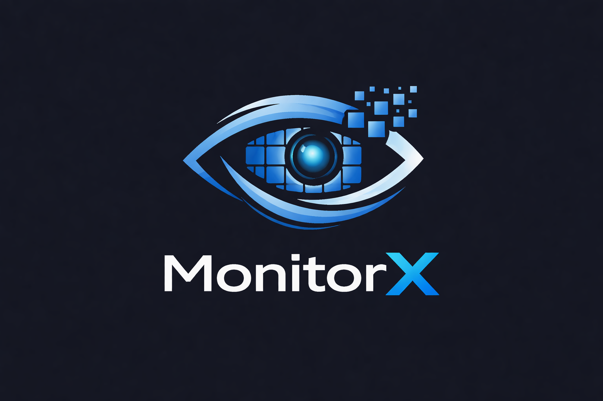

<div align="center">
  <table width="100%">
    <tr>
      <td align="center" width="30%">
        
      </td>
      <td align="left" width="70%">
        <h1>MonitorX</h1>
        <p><strong>Enterprise-Grade Real-Time Monitoring & Interaction Platform</strong></p>
        <p><em>Empowering seamless, zero-latency classroom workflows with Next-Gen P2P WebRTC.</em></p>
      </td>
    </tr>
  </table>

  <br/>

  [](https://reactjs.org/)
  [](https://vitejs.dev/)
  [](https://www.typescriptlang.org/)
  [](https://tailwindcss.com/)
  [](https://supabase.io/)
</div>

<br/>

**MonitorX** is a high-fidelity, highly scalable platform designed for seamless remote screen monitoring, built specifically for educational environments, classrooms, and enterprise training labs. MonitorX removes the friction of remote oversight by allowing hosts to see all participant screens in a synchronized live grid with zero latency, entirely powered by seamless WebRTC connections.

## ✨ Key Features

- 📹 **Real-Time Grid Monitoring**: Instructors/Hosts can view up to 20 screens simultaneously in a dynamic, configurable grid. 
- 🚀 **High-Performance WebRTC**: Peer-to-peer screen sharing with optimized ICE candidate queuing to prevent handshaking drops. Signaled completely over Supabase's Realtime Broadcast.
- 💬 **Integrated Chat System**: Supports bidirectional communication between the Host and Participants, featuring both Global/Group channels and isolated Private Direct Messaging.
- ✋ **Ephemeral Reactions & Alerts**: Participants can seamlessly send animated "Help" / "Raise Hand" alerts that appear directly on their tile inside the Host's grid via Framer Motion. 
- 🎨 **Premium UI/UX**: State-of-the-art "Indigo Nexus" aesthetics featuring glassmorphism, responsive components, curved SVG typography, and dark-themed sci-fi monitoring aesthetics.
- 🔐 **Roles & Access Control**: Differentiated dashboards for Hosts (Create Session, Manage Grid) and Participants (Enter code, Share Screen, Chat).

## 🛠 Tech Stack

- **Frontend Framework**: [React 18](https://reactjs.org/) with [Vite](https://vitejs.dev/)
- **Language**: [TypeScript](https://www.typescriptlang.org/)
- **Styling**: [Tailwind CSS v3](https://tailwindcss.com/)
- **Animations**: [Framer Motion](https://www.framer.com/motion/)
- **Icons**: [Lucide React](https://lucide.dev/)
- **Backend & Realtime Signalling**: [Supabase](https://supabase.com/) (Postgres DB, Auth, Realtime Broadcast Channels)

## 📦 Local Development

### Prerequisites

- Node.js (v18+)
- A [Supabase](https://supabase.com/) project to handle the Backend as a Service & Signaling.

### Installation

1. **Clone the repository:**
   ```bash
   git clone https://github.com/Atharv1136/MonitorX.git
   cd MonitorX
   ```

2. **Install dependencies:**
   ```bash
   npm install
   ```

3. **Set up Environment Variables:**
   Create a `.env` file at the root of the project with your Supabase credentials:
   ```env
   VITE_SUPABASE_URL=your_supabase_url
   VITE_SUPABASE_ANON_KEY=your_supabase_anon_key
   ```

4. **Start the Development Server:**
   ```bash
   npm run dev
   ```

### WebRTC Notes & Local Testing

Screen sharing via `navigator.mediaDevices.getDisplayMedia()` **requires a secure context (HTTPS)** or `localhost`. 
1. If testing on multiple devices locally, ensure you either forward the port via a secure tunnel (like `ngrok`) or configure Vite to use basic SSL.
2. If testing in multiple tabs on the same machine, `localhost:5173` will successfully trigger the browser's sharing permissions.

## 🗄 Database Schema Highlights

The application relies on Supabase Postgres tables to maintain states that supplement real-time channels:

- **`sessions`**: `id`, `host_id`, `name`, `code`, `status`, `max_participants`
- **`session_participants`**: `session_id`, `user_id`, `joined_at`, `stream_active`
- **`messages`**: `id`, `session_id`, `sender_id`, `recipient_id`, `content`, `is_private`

*(Signaling for WebRTC is ephemeral and handled entirely via Supabase Broadcast without writing into the DB, meaning blazing fast connections!)*

---

<div align="center">
  <sub>Built with ❤️ for modern teaching and monitoring.</sub>
</div>
